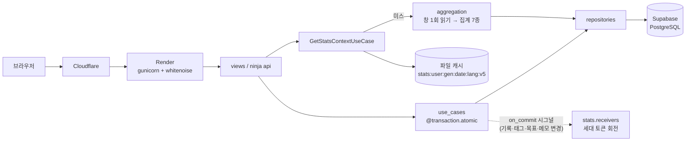

# LifeDiary

하루를 144개의 10분 슬롯으로 기록하고, 태그로 분류해 생활 패턴을 통계로 돌려주는 Django 웹 서비스다.

| | |
|---|---|
| 서비스 | https://lifediary.kr (운영 중) |
| API 문서 | https://lifediary.kr/api/docs (Swagger UI, 데이터 엔드포인트는 세션 인증 뒤) |
| 기간 | 2025-07-21 ~ 진행 중 (이 문서는 2026-10-28 코드 기준) |
| 형태 | 1인 개발 |
| 배포 | Render(gunicorn + whitenoise) + Supabase PostgreSQL + Cloudflare, GitHub Actions |
| 스택 | Python 3.13 · Django 5.2 · django-ninja · pytest · django-allauth · django-axes · openpyxl |

혼자 만들어 혼자 운영하는 서비스라 사용자 수나 요청량 통계는 수집하지 않는다. 아래 성능 수치는 운영 계정 1개를 대상으로 직접 잰 값이고, 기업 실무나 다수 사용자 운영 경험은 아니다. 개발에는 Claude Code를 썼다. 커밋의 `Co-Authored-By`가 그 범위를 보여 주고, 역할 분리·TDD·훅 규칙은 `lifeDiary/AGENTS.md`에 정리해 두었다.

---

## 1. 요약

운영하면서 고친 문제 가운데 과정이 기록으로 남은 것은 네 가지다. 각각의 자세한 경위는 4장에 적었다.

- **통계 쿼리 29개 → 5개.** 통계 화면이 목표 수에 비례해 쿼리를 늘리고 있었다. 운영 계정(목표 약 10개)에서 쿼리 29개, 캐시 미스 TTFB 중앙값 3,294ms였다. 목표별 조회를 범위 1회 읽기로 바꿔 20개로 줄이고, 요청이 쓸 기간 전체를 한 번 읽어 집계마다 잘라 쓰게 해서 5개로 끝냈다. 운영 미스 TTFB는 3,294ms에서 1,144ms로 내려갔다(−65%, 2026-09-30 → 10-02, 같은 계정·날짜 5개 중앙값, `Server-Timing` 헤더). 10-06에 운영 쿼리 5개를 다시 확인했고, 쿼리 상한 5는 `test_stats_perf.py`가, 창 읽기는 `test_stats_window.py` 15건이 테스트로 고정한다.
- **통계 캐시의 세대 토큰.** 캐시 무효화가 날짜 단위라 주·월 집계와 태그·목표·메모 변경이 TTL(24h)까지 옛 값으로 보였다. 사용자별 무작위 세대 토큰을 키에 넣고, 쓰기 유스케이스가 `transaction.on_commit`으로 시그널을 보내면 `stats`가 토큰을 회전하게 했다. `test_cache_invalidation.py` 6건이 롤백된 저장은 캐시를 유지하고, 커밋된 저장은 다른 날짜의 주간 합계까지 갱신하는 것을 확인한다.
- **태그 표시명을 식별자로 쓰던 집계 오류.** 집계가 태그 표시명을 dict key로 쓰고 있어서, 사용자가 `미분류`라는 태그를 만들면 합성 미기록 항목과 병합됐다. 일간은 10분이 1,440분으로 잡히고 주간은 `TypeError`로 500이 났다. key를 `tag:<id>` / `unclassified`로 고정하는 모듈을 두고 집계 4종과 '7일 평균 대비' 조회를 식별자 기반으로 바꿨다. 2026-10-28에 수정했고 `test_tag_identity.py` 9건이 Red에서 Green으로 넘어갔다. 전체 725 passed.
- **API 인증과 오류 응답.** JSON API를 로그인 없이 부르면 302 뒤에 로그인 HTML이 200으로 돌아와서 클라이언트가 실패 원인을 알 수 없었다. API 5개를 django-ninja로 이식하면서 전역 예외 핸들러로 401/400/404 봉투를 통일했다. 이식 직전에 현재 계약을 보호 테스트로 고정했고(커밋 `b8c81bf`), URL과 응답 모양은 그대로 두었다. `test_undo_requires_login`이 401을 확인하고, `test_api_docs.py`는 엔드포인트가 OpenAPI에서 빠지면 실패한다.

---

## 2. 무엇을 하는 서비스인가

기록은 "쓸 게 많으면 안 쓴다"는 문제에서 출발했다. 그래서 입력은 슬롯 선택과 태그 지정으로 줄이고, 복잡한 부분은 쌓인 기록을 통계로 돌려주는 쪽에 몰았다.

1. 대시보드에서 하루를 10분 슬롯으로 기록한다. 저장과 삭제는 60초 안에 되돌릴 수 있다.
2. 카테고리(투자·주도적 사용·수동적 소비·기초 생활·수면) 아래 개인 태그로 분류한다. 태그를 지우면 기록을 다른 태그로 이관하거나 함께 지운다.
3. 태그별로 일·주·월 목표 시간과 선택 기한(D-day)을 둔다.
4. 일·주·월·분석 4종 통계와 월간 엑셀 내보내기로 패턴을 본다.

계정은 이메일 6자리 코드 인증(해시 저장, 10분, 3회), Google 로그인, 15일 유예 탈퇴와 마스킹 감사 기록을 갖는다. 모든 문자열은 ko/en 카탈로그로 번역된다.

---

## 3. 구성

| 영역 | 선택 | 이유 |
|---|---|---|
| 프레임워크 | Django 5.2 모놀리스, 앱 5개(`core`, `dashboard`, `tags`, `users`, `stats`) | 1인 개발에서는 앱 단위 경계로 충분하다. 서비스 분리는 하지 않는다 |
| 계층 | `views/api → use_cases(@atomic) → repositories/domain_services → models` | 쓰기 트랜잭션과 커밋 뒤 시그널의 경계를 유스케이스 한 곳에 둔다 |
| JSON API | django-ninja + OpenAPI | 함수 뷰의 로그인 리다이렉트가 API 응답에 섞이던 문제를 전역 예외 핸들러로 닫았다 |
| DB | Supabase PostgreSQL(Transaction Pooler 6543), 로컬은 SQLite | 운영은 관리형 PostgreSQL, 테스트는 SQLite로 약 34초. `select_for_update` 같은 잠금은 SQLite 테스트에서 검증되지 않는다 |
| 캐시 | 파일 캐시(통계, `/tmp`) + `DatabaseCache`(보안 카운터) | 외부 캐시 서비스 없이 인스턴스 1개를 전제한다. 브루트포스 카운터는 통계 캐시의 cull과 재배포에 지워지지 않도록 DB로 분리했다(2026-10-11) |
| 보안 | django-axes, 5회 실패 뒤 reCAPTCHA, CSP, 쿠키 하드닝, HSTS | `docs/security/` 기록 참고 |

요청이 지나가는 경로는 다음과 같다.



`stats`는 네 시그널을 구독만 한다. `dashboard`가 `stats`를 import하지 않는 방향은 `apps/dashboard/test_domain_boundaries.py`가 AST로 검사한다.

DB 제약과 인덱스는 다음 다섯 가지다.

| 대상 | 내용 | 이유 |
|---|---|---|
| `TimeBlock` | `UniqueConstraint(user, date, slot_index)` | 같은 시간대에 기록이 둘이면 하루 합이 24시간을 넘는다. 초기 마이그레이션(`0001`)부터 DB 제약으로 뒀다. 동시 저장 요청을 재현하는 테스트는 없다 |
| `TimeBlock` | `tag` NOT NULL | 태그 없는 기록은 통계에서 분류할 수 없다. 남아 있던 190건을 정리하는 마이그레이션(`dashboard/0007`)과 함께 필수로 바꿨다 |
| `TimeBlock` | `Index(user, date)` / `Index(user, tag)` | "이 사용자의 이 날짜"가 주 조회 축이다. `(user, tag)`는 현재 조회 경로에 쓰는 곳이 없다(태그 이관·삭제는 `tag` 단일 조건) |
| `Tag` | `UniqueConstraint(user, name)` | 태그는 전부 개인 소유이고 이름은 사용자 안에서 유일하다 |
| `AccountDeletionRequest` | `OneToOneField(user)` + `select_for_update()` + `Index(scheduled_delete_at)` | 취소 뒤 재요청이 두 번째 행을 만들며 `IntegrityError`를 내던 것을 기존 행 재사용으로 고쳤다(2026-08-16). `select_for_update`는 같은 사용자의 동시 재요청을 직렬화하려는 의도이고 동시성 테스트는 없다. 인덱스는 만기 계정을 골라내는 purge 배치용이다 |

---

## 4. 문제를 고친 과정

### 4-1. 통계 쿼리가 목표 수에 비례해 늘던 문제

통계 화면은 집계 7종을 한 요청에서 돈다. 쿼리 수 상한은 2026-04부터 테스트로 고정해 두었는데, 2026-08-17에 목표 진행 바를 붙이면서 목표마다 그 기간의 합계를 조회하는 N+1이 들어갔다. 온보딩에서 "목표는 하나면 충분하다"고 안내하고 있었기 때문에 알고도 그대로 두었다.

2026-09-30에 `Server-Timing` 헤더를 달고 운영 계정(목표 약 10개)을 재 보니 캐시 미스 TTFB 중앙값이 3,294ms였다. 그중 DB가 2,363ms(72%)였고 쿼리는 29개였다. 쿼리당 80ms 이상이 걸리는 것은 Render(싱가포르)와 Supabase(도쿄) 사이 왕복 때문이라고 추정했다. 같은 쿼리가 로컬 PostgreSQL에서는 요청 전체가 849ms로 끝난다는 것이 근거였고, 왕복 지연 자체를 따로 재지는 않았다.

리전을 옮기는 방법도 있었다. 그런데 DB 마이그레이션과 중단이 따르고, 옮긴다고 쿼리 수 문제가 사라지지는 않는다. 그래서 쿼리 수부터 줄였다. 1단계(10-01)에서는 모든 목표 기간을 덮는 범위를 한 번 읽어 N+1을 없앴다. 쿼리는 29개에서 20개로 줄었다(−30%). 2단계(10-02)에서는 요청이 쓸 기간 전체(12주 기준선부터 주말·월말까지)를 한 번 읽고 각 집계가 제 기간만 잘라 쓰게 했다. 이렇게 해서 5개가 됐다. 창이 어떤 기간을 덮지 못하면 그 집계가 따로 읽어 쿼리 상한을 넘기므로, 창 계산이 틀려도 같은 테스트에서 잡힌다.

운영 미스 TTFB는 3,294 → 2,291 → 1,144ms로 내려갔고 적중은 446ms였다(같은 계정, 날짜 5개 중앙값). 로컬에서 목표를 0개, 6개, 12개로 바꿔도 쿼리는 모두 5개였고, 운영에서도 5개였다(10-06 재측정, 미스 969ms).

남은 미스 약 1초는 리전 왕복이 바닥이라고 보고 있다. 리전 일치는 보류했다. 측정은 계정 1개로 했고 부하 테스트는 하지 않았다.

→ 상세: [docs/performance/2026-10-02_stats-query-consolidation.md](lifeDiary/docs/performance/2026-10-02_stats-query-consolidation.md)

### 4-2. 태그 표시명을 식별자로 쓰던 데이터 정합성 결함

사용자가 태그 이름을 `미분류`로 지으면 일간 통계에서 10분 기록이 1,440분으로 잡혔다. 주간 집계는 `TypeError`가 나서 통계 화면이 500으로 끝났고, 월간과 분석에서는 그 태그가 744시간으로 표시됐다.

코드를 보니 집계 4종이 태그 표시명을 dict key로 쓰고 있었다. 빈 시간을 채우는 합성 항목은 상수 `"미분류"`를 key로 썼기 때문에, 두 key가 같아지면 합성 항목의 분이 실제 태그에 더해졌다. 영어 UI에서는 표시명만 번역되어 결함이 드러나지 않았다. 근본 원인은 사용자가 바꿀 수 있는 값을 식별자로 쓴 것이다.

`미분류`를 예약어로 막는 방법은 언어마다 예약어가 늘어나고 구조는 그대로라서 택하지 않았다. 대신 key 계약을 소유하는 모듈(`identity.py`)을 두고 key를 `tag:<id>` / `unclassified`로 고정한 뒤, 집계 4종과 합성 항목 빌더를 key 기반으로 바꿨다. 표시명은 entry의 `name`에 남겨서 템플릿과 JS는 손대지 않았다.

재현 테스트 8건(ko/en)을 먼저 써서 구현 전에 실패하는 것을 확인했다. 주간은 `TypeError`로, 나머지는 `key`가 없어서 실패했고, 단언 메시지에 1,440분과 744h 병합이 그대로 찍혔다. 같은 뿌리의 문제가 '7일 평균 대비' 열에도 있었다. 합성 행이 실제 태그의 값을 빌려 오고 있어서 이름 조회를 `tag_id`로 바꾸고 테스트 1건을 더했다. 구현 뒤 전체 725 passed였고, `/stats/`가 200을 돌려주며 두 행으로 나뉘는 것을 확인했다.

이 수정은 사실 2026-08-15 로컬 브랜치에 이미 있었다. 그런데 병합되지 않았고, 2026-10-04 선별 재적용에서도 빠졌다. README에는 "해결"이라고 적어 둔 채 두 달이 지났고, 2026-10-28 README를 다시 쓰면서 코드와 대조하다가 발견했다. 기간 비교와 요약 관찰은 아직 이름으로 합산한다. 사용자 안에서 이름이 유일하므로 여기서는 병합이 생기지 않는다.

→ 상세: [docs/architecture/2026-10-28_tag-identity-separation.md](lifeDiary/docs/architecture/2026-10-28_tag-identity-separation.md)

### 4-3. 통계 캐시가 바뀐 기록을 모르던 문제

캐시 키는 `stats:{user}:{date}:{lang}`이었고, 무효화는 슬롯이 바뀐 날짜의 키만 지웠다. 그 날짜를 포함하는 주간·월간 조회나 태그·목표·메모 변경은 TTL까지 옛 값이 보였다. 무효화 단위는 날짜인데 캐시가 담는 범위는 주·월·목표·메모까지라서 둘이 맞지 않았던 것이다.

영향받는 키를 계산해서 지우는 방식은 12주 기준선 때문에 최대 84개 키를 다뤄야 하고, 태그·목표·메모 변경에는 기준이 될 날짜조차 없다. 사용자별 세대 토큰을 키에 넣는 쪽을 택했다. 변경 한 번에 그 사용자의 옛 키 전부가 닿을 수 없게 된다. 토큰은 숫자를 올리는 대신 무작위 값을 쓴다. 파일 캐시의 `incr()`가 원자적이지 않고, 토큰이 캐시에서 밀려났다 돌아올 때 옛 세대 키가 되살아나면 안 되기 때문이다. 시그널은 `transaction.on_commit`으로만 보낸다. 트랜잭션 안에서 보내면 다른 요청이 아직 반영되지 않은 데이터로 새 세대의 캐시를 채운다.

`test_cache_invalidation.py` 6건으로 롤백 시 캐시 적중이 유지되는지, 커밋 시 다른 날짜의 주간 합계가 갱신되는지, 태그 이름 변경이 반영되는지 확인한다. 운영에서도 다른 날짜를 저장하면 적중이 미스로 바뀌는 것을 봤다(2026-10-06).

한계도 있다. 변경 하나가 그 사용자의 전체 통계 캐시를 버린다. 관리자 화면에서 편집하면 세대가 바뀌지 않는다. 캐시 쓰기가 실패하면 500이고, `on_commit` 콜백의 토큰 회전이 실패하면 DB는 커밋됐는데 응답은 500이 된다. 파일 캐시는 인스턴스마다 따로라서 인스턴스를 늘리면 세대 토큰이 갈라진다. 그때는 Redis 같은 공유 캐시로 옮겨야 한다.

→ 상세: [docs/architecture/2026-10-04_stats-cache-generation.md](lifeDiary/docs/architecture/2026-10-04_stats-cache-generation.md)

### 4-4. 보안과 API

- **저장형 XSS**(2026-04-21): 통계 페이지가 태그명이 든 JSON을 `|safe`로 `<script>` 안에 넣고 있어서 `</script>`로 탈출할 수 있었다. `json_script` 4개로 바꿨다. 적대적 태그명이 이스케이프되는지는 `test_sidebar_tag_button_escapes_hostile_name`, `test_tag_badge_clickable_escapes_hostile_name`이 확인한다.
- **API 오류 봉투**(2026-08-16): 미인증은 401 `UNAUTHORIZED`, 스키마 실패는 400 `VALIDATION_ERROR`, JSON이 아니면 400 `INVALID_JSON`, 없거나 남의 태그는 404 `TAG_NOT_FOUND`를 돌려준다. 남의 태그에 403 대신 404를 쓰는 이유는 403이 "그 id는 존재한다"를 알려 주기 때문이다. 이식 전에는 없거나 남의 태그에 PUT/DELETE를 보내면 500이 났고, Red-Green으로 404 봉투로 바꿨다(커밋 `11e1be9`).
- **브루트포스**: django-axes(잠금 키 `REMOTE_ADDR`), 5회 실패 뒤 reCAPTCHA, 복구·가입 검증 엔드포인트의 캐시 스로틀. 카운터는 `security` 캐시 별칭(`DatabaseCache`)에 둔다.
- 상세: [docs/security/2026-04-21_xss-bruteforce-sri-remediation.md](lifeDiary/docs/security/2026-04-21_xss-bruteforce-sri-remediation.md), [docs/architecture/2026-08-16_api-documentation-guide.md](lifeDiary/docs/architecture/2026-08-16_api-documentation-guide.md)

---

## 5. 배포, 테스트, 운영

| 항목 | 내용 |
|---|---|
| 런타임 | Render, `gunicorn --workers=2 --threads=4`, whitenoise 매니페스트 정적 파일, `lifeDiary/settings/prod.py` |
| DB·외부 | Supabase PostgreSQL(Pooler 6543, `CONN_MAX_AGE=60`), Cloudflare, Gmail SMTP, Google OAuth, reCAPTCHA |
| PR 검사 | `pr-checks.yml`: ruff, `manage.py check`(dev·desktop), 마이그레이션 드리프트, 전체 pytest, prod `--deploy` 검사, 브라우저 JS `node --check`, 번역 카탈로그 fuzzy·미번역 0건 |
| 배포 | `main` 머지 → `deploy-pr.yml`이 `production`행 PR을 갱신 → `deploy.yml`(`workflow_dispatch`, dry-run 기본)이 문서를 뺀 트리를 fast-forward 커밋. `production`에만 있는 blob을 찾으면 중단한다(2026-08-12 도메인 수정 유실 사고 뒤에 넣은 장치) |
| 배치 | 탈퇴 유예 만료 계정 purge 매일 03:47 KST, `pg_dump` + age 암호화 백업 매일 04:17 KST(아티팩트 30일), 복호화·`pg_restore` 리허설 2026-10-11 |
| 관측 | `django.request` ERROR를 콘솔과 관리자 메일(`AdminEmailHandler`)로 보내고, 통계 `Server-Timing` 헤더는 운영 스위치로 켠다. 메트릭 대시보드는 없다 |

코드는 Python 약 17,200줄(마이그레이션 제외, 테스트 포함)이고 운영 코드는 약 7,700줄이다. pytest는 725개가 통과한다(2026-10-28, 로컬 SQLite 약 34초). 2026-10-11에 테스트 비밀번호 해시를 MD5로 바꿨더니 같은 날 같은 환경에서 548초 걸리던 것이 30초로 줄었다. 프런트엔드는 자동 테스트 없이 브라우저에서 검증하고, 마크업·CSS·JS 소스 문자열을 단언하는 테스트는 두지 않는다. 테스트 명명과 경계 정책은 `lifeDiary/.claude/rules/backend-tests.md`에 있다.

운영에서 확인된 문제와 아직 남아 있는 한계는 다음과 같다.

- 통계 캐시 미스 약 1초: Render(싱가포르) ↔ Supabase(도쿄) 왕복으로 추정. 리전 일치 보류
- 동시 요청(같은 슬롯 동시 저장, 탈퇴 동시 재요청)을 재현하는 테스트가 없다. DB 제약과 행 잠금에 기대고 있다
- 기록 저장 API TTFB 약 1.2초, 쿼리 수·DB 시간 미계측
- Render 프록시 뒤 `REMOTE_ADDR` 실측 전. axes 잠금 키와 레이트리밋 키가 이 값이라 `AXES_FAILURE_LIMIT` 기본 1000을 내리지 못했다
- CSP가 `'unsafe-inline'`·`'unsafe-eval'`을 허용한다(인라인 스크립트 잔존)
- 목표의 (사용자, 태그, 기간) 유일성은 폼 검증만 있고 DB 제약이 없다
- Google 가입은 제공자 미인증 주소도 받는다(인증 표시만 한정)
- Gmail SMTP 발송량 한도 미확인. 메일 발신 전용 도메인 없음
- 데스크톱 앱(pywebview + waitress + PyInstaller): 런처와 설정만 있고 패키징 미완

전체 백로그는 [docs/CHANGELOG.md](lifeDiary/docs/CHANGELOG.md)의 `미해결`에 있다.

---

## 6. 실행 방법

```bash
cd lifeDiary
cp .env.example .env            # DJANGO_SECRET_KEY 는 필수. 나머지는 비워도 dev 가 뜬다
python -m venv .venv && source .venv/bin/activate   # 저자는 conda env `knou-life-diary` 를 쓴다
pip install -r requirements.txt
python manage.py migrate
python manage.py runserver      # http://127.0.0.1:8000
pytest                          # lifeDiary.settings.dev, SQLite, --reuse-db
```

`.env`에 실제 비밀값을 넣지 않는다. 운영 환경변수 목록은 `lifeDiary/.env.example`에 있다.

---

## 7. 상세 문서

| 주제 | 문서 |
|---|---|
| 아키텍처·도메인 규칙·대표 요청 플로우(Mermaid) | [docs/architecture/2026-04-21_business-logic-and-architecture-guide.md](lifeDiary/docs/architecture/2026-04-21_business-logic-and-architecture-guide.md) |
| 통계 쿼리 통합(29 → 5, 측정 조건) | [docs/performance/2026-10-02_stats-query-consolidation.md](lifeDiary/docs/performance/2026-10-02_stats-query-consolidation.md) |
| 통계 캐시 세대 토큰 | [docs/architecture/2026-10-04_stats-cache-generation.md](lifeDiary/docs/architecture/2026-10-04_stats-cache-generation.md) |
| 태그 식별자·표시명 분리 | [docs/architecture/2026-10-28_tag-identity-separation.md](lifeDiary/docs/architecture/2026-10-28_tag-identity-separation.md) |
| API(OpenAPI) 구조와 응답 계약 | [docs/architecture/2026-08-16_api-documentation-guide.md](lifeDiary/docs/architecture/2026-08-16_api-documentation-guide.md) |
| 보안 수정 기록(XSS·브루트포스·SRI) | [docs/security/2026-04-21_xss-bruteforce-sri-remediation.md](lifeDiary/docs/security/2026-04-21_xss-bruteforce-sri-remediation.md) |
| 백업·복구 절차 | [docs/operations/2026-10-11_backup-and-recovery.md](lifeDiary/docs/operations/2026-10-11_backup-and-recovery.md) |
| 변경 기록과 백로그 | [docs/CHANGELOG.md](lifeDiary/docs/CHANGELOG.md) |
| 2026-07-18 전수 검토 | [docs/2026-07-18_comprehensive-project-review.md](lifeDiary/docs/2026-07-18_comprehensive-project-review.md) |
| 로드맵(데스크톱·배포·수익화) | [docs/plans/](lifeDiary/docs/plans/) |
| 작업 규칙(역할·TDD·훅) | [lifeDiary/AGENTS.md](lifeDiary/AGENTS.md), [lifeDiary/CLAUDE.md](lifeDiary/CLAUDE.md) |
