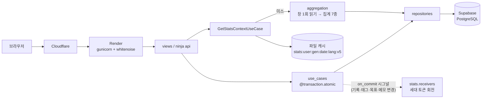

# LifeDiary

하루를 144개의 10분 슬롯으로 기록하고, 태그로 분류해 생활 패턴을 통계로 돌려주는 Django 웹 서비스다.

| | |
|---|---|
| 서비스 | https://lifediary.kr (운영 중) |
| API 문서 | https://lifediary.kr/api/docs (Swagger UI, 데이터 엔드포인트는 세션 인증 뒤) |
| 기간 | 2025-07-21 ~ 진행 중 (이 문서는 2026-10-28 코드 기준) |
| 형태 | 1인 개발 |
| 배포 | Render(gunicorn + whitenoise) + Supabase PostgreSQL + Cloudflare, GitHub Actions |
| 스택 | Python 3.13 · Django 5.2 · django-ninja · pytest · django-allauth · django-axes · openpyxl |
| 규모 | Python 약 17,200줄(마이그레이션 제외, 테스트 포함), 운영 코드 약 7,700줄, pytest 725개 통과(2026-10-28) |

사용자 수·요청량 통계는 수집하지 않는다. 이 문서의 성능 수치는 운영 계정 1개를 대상으로 직접 측정한 값이다.

---

## 1. 핵심 성과

| 문제 | 해결 방법 | 검증 결과 |
|---|---|---|
| 통계 화면이 목표 수에 비례해 쿼리를 늘렸다. 운영 계정(목표 약 10개)에서 쿼리 29개, 캐시 미스 TTFB 중앙값 3,294ms | 목표별 조회를 범위 1회 읽기로 바꾸고(29 → 20), 요청이 쓸 기간 전체를 한 번 읽어 집계마다 잘라 쓰게 했다(→ 5). 쿼리 상한을 테스트로 고정 | 운영 미스 TTFB 3,294 → 1,144ms(−65%, 2026-09-30 → 10-02, `Server-Timing` 헤더). `test_stats_perf.py` 상한 5, `test_stats_window.py` 15건 |
| 통계 캐시 무효화가 날짜 단위라 주·월 집계와 태그·목표·메모 변경이 TTL(24h)까지 옛 값으로 보였다 | 사용자별 무작위 세대 토큰을 키에 넣고, 쓰기 유스케이스가 `transaction.on_commit`으로 시그널을 보내면 `stats`가 토큰을 회전 | `test_cache_invalidation.py` 6건. 롤백된 저장은 캐시를 유지, 커밋된 저장은 다른 날짜의 주간 합계까지 갱신 |
| 집계가 태그 표시명을 dict key로 써서, 사용자 태그 `미분류`가 합성 미기록 항목과 병합됐다. 일간 10분 → 1,440분, 주간은 `TypeError`로 500 | key를 `tag:<id>` / `unclassified`로 고정하는 모듈을 두고 집계 4종과 '7일 평균 대비' 조회를 식별자 기반으로 전환. 표시명은 표시 전용 | 2026-10-28 수정. `test_tag_identity.py` 9건 Red → Green, 전체 725 passed |
| JSON API를 로그인 없이 부르면 302 → 로그인 HTML 200이 돌아와 클라이언트가 실패 원인을 몰랐다 | API 5개를 django-ninja로 이식하며 전역 예외 핸들러로 401/400/404 봉투를 통일. URL·응답 모양은 특성화 테스트로 고정한 채 이식 | `test_undo_requires_login`(401), `test_api_docs.py`(엔드포인트가 OpenAPI에서 빠지면 실패) |

---

## 2. 해결하려는 문제와 핵심 흐름

기록은 "쓸 게 많으면 안 쓴다"는 문제에서 출발했다. 입력은 슬롯 선택 + 태그 지정으로 줄이고, 복잡도는 쌓인 기록을 통계로 돌려주는 쪽에 몰았다.

1. 대시보드에서 하루를 10분 슬롯으로 기록한다. 저장·삭제는 60초 안에 되돌릴 수 있다.
2. 카테고리(업무·이동·돌봄·생활·수면) 아래 개인 태그로 분류한다. 태그를 지우면 기록을 다른 태그로 이관한다.
3. 태그별 일·주·월 목표 시간과 선택 기한(D-day)을 둔다.
4. 일·주·월·분석 4종 통계와 월간 엑셀 내보내기로 패턴을 본다.

계정은 이메일 6자리 코드 인증(해시 저장, 10분, 3회), Google 로그인, 15일 유예 탈퇴와 마스킹 감사 기록을 갖는다. 모든 문자열은 ko/en 카탈로그로 번역된다.

---

## 3. 기술 구성과 요청 흐름

| 영역 | 선택 | 이유 |
|---|---|---|
| 프레임워크 | Django 5.2 모놀리스, 앱 5개(`core`, `dashboard`, `tags`, `users`, `stats`) | 1인 개발에서 경계는 앱 단위로 충분하다. 서비스 분리는 하지 않는다 |
| 계층 | `views/api → use_cases(@atomic) → repositories/domain_services → models` | 쓰기 트랜잭션과 커밋 뒤 시그널의 경계를 유스케이스 한 곳에 둔다 |
| JSON API | django-ninja + OpenAPI | 함수 뷰의 로그인 리다이렉트가 API에 섞이던 문제를 전역 예외 핸들러로 닫았다 |
| DB | Supabase PostgreSQL(Transaction Pooler 6543), 로컬은 SQLite | 운영은 관리형 PostgreSQL, 테스트는 SQLite로 30초 안에 끝낸다 |
| 캐시 | 파일 캐시(통계) + `DatabaseCache`(보안 카운터) | 브루트포스 카운터가 통계 캐시의 cull과 재배포에 지워지지 않게 분리했다(2026-10-11) |
| 보안 | django-axes, 5회 실패 뒤 reCAPTCHA, CSP, 쿠키 하드닝, HSTS | `docs/security/` 기록 참고 |



`stats`는 네 시그널을 구독만 하고, `dashboard`가 `stats`를 import하지 않는 방향은 `apps/dashboard/test_domain_boundaries.py`가 AST로 고정한다.

주요 제약과 인덱스:

| 대상 | 내용 | 이유 |
|---|---|---|
| `TimeBlock` | `UniqueConstraint(user, date, slot_index)` | 같은 시간대에 기록이 둘이면 하루 합이 24시간을 넘는다. 동시 요청은 애플리케이션 검증으로 못 막아 DB로 내렸다 |
| `TimeBlock` | `tag` NOT NULL | 태그 없는 기록은 통계에서 분류할 수 없다. 남아 있던 190건을 정리하는 마이그레이션(`dashboard/0007`)과 함께 필수로 바꿨다 |
| `TimeBlock` | `Index(user, date)` / `Index(user, tag)` | "이 사용자의 이 날짜", "태그별 합계"가 주 조회 축 |
| `Tag` | `UniqueConstraint(user, name)` | 태그는 전부 개인 소유이고 이름은 사용자 안에서 유일하다 |
| `AccountDeletionRequest` | `select_for_update()` + `Index(scheduled_delete_at)` | 탈퇴 취소 뒤 재요청이 `IntegrityError`를 내던 경쟁을 행 잠금으로 막고, 만기 계정만 골라내는 배치 조회를 인덱스로 받는다 |

---

## 4. 핵심 문제 해결 사례

### 4-1. 통계 쿼리가 목표 수에 비례해 늘던 문제

**문제** — 통계 화면은 집계 7종을 한 요청에 돈다. 쿼리 수 상한은 2026-04부터 테스트가 고정했지만, 2026-08-17 목표 진행 바가 목표마다 그 기간의 합계를 조회하는 N+1을 더했다. 온보딩이 "목표는 하나면 충분하다"고 안내해 알고도 뒀다.

**원인 분석** — 2026-09-30 `Server-Timing` 헤더로 운영 계정(목표 약 10개)을 재니 캐시 미스 TTFB 중앙값 3,294ms 중 DB가 2,363ms(72%), 쿼리 29개였다. 쿼리당 80ms 이상은 Render(싱가포르) ↔ Supabase(도쿄) 왕복이다.

**선택** — 리전 이전은 DB 마이그레이션과 중단이 따르고 쿼리 수 문제는 남는다. 쿼리 수를 먼저 줄였다. 1단계(10-01)는 모든 목표 기간을 덮는 범위를 한 번 읽어 N+1을 없앴다(29 → 20, −30%). 2단계(10-02)는 요청이 쓸 기간 전체(12주 기준선 ~ 주말·월말)를 한 번 읽고 각 집계가 제 기간만 잘라 쓰게 했다(→ 5). 창이 어떤 기간을 덮지 못하면 따로 읽어 상한을 넘기므로, 창 계산이 틀려도 같은 테스트가 잡는다.

**검증** — 운영 미스 TTFB 3,294 → 2,291 → 1,144ms, 적중 446ms. 로컬 쿼리 목표 0/6/12개 모두 5개.

**한계** — 미스 약 1초의 바닥은 리전 왕복이다. 리전 일치는 보류했다. 측정은 계정 1개, 날짜 5개의 중앙값이다.

→ 상세: [docs/performance/2026-10-02_stats-query-consolidation.md](lifeDiary/docs/performance/2026-10-02_stats-query-consolidation.md)

### 4-2. 태그 표시명을 식별자로 쓰던 데이터 정합성 결함

**문제** — 사용자가 태그 이름을 `미분류`로 지으면 일간 통계에서 10분 기록이 1,440분으로 잡히고, 주간 집계는 `TypeError`로 통계 화면이 500으로 끝났다. 월간·분석에서는 그 태그가 744시간으로 표시됐다.

**원인 분석** — 집계 4종이 태그 표시명을 dict key로 썼고, 빈 시간을 채우는 합성 항목은 상수 `"미분류"`를 key로 썼다. 두 key가 같으면 합성 항목의 분이 실제 태그에 더해진다. 영어 UI는 표시명만 번역돼 결함이 가려졌다. 근본 원인은 사용자가 바꿀 수 있는 값을 식별자로 쓴 것이다.

**선택** — 예약어로 막는 대안은 언어마다 예약어가 늘고 구조는 그대로라 기각했다. key 계약을 소유하는 모듈(`identity.py`)을 두고 `tag:<id>` / `unclassified`로 고정한 뒤, 집계 4종과 합성 항목 빌더를 key 기반으로 바꿨다. 표시명은 entry의 `name`에 남아 템플릿·JS는 바뀌지 않았다.

**검증** — 재현 테스트 8건(ko/en)을 먼저 써서 구현 전 실패를 확인했다(주간 `TypeError`, 나머지는 `key` 부재. 단언 메시지에 1,440분·744h 병합이 찍혔다). 같은 뿌리인 '7일 평균 대비' 열의 이름 조회도 `tag_id`로 바꿨다(합성 행이 실제 태그 값을 빌리던 것, 테스트 1건). 구현 뒤 전체 725 passed, `/stats/`가 200을 돌려주고 두 행으로 나뉘는 것을 확인했다.

**한계** — 이 수정은 2026-08-15 로컬 브랜치에 있었으나 병합되지 않았고, 2026-10-04 선별 재적용에서 빠졌다. README가 "해결"이라 적은 채 두 달이 지났다. 이번 재작성에서 코드와 대조하다 발견했다. 기간 비교·요약 관찰은 아직 이름으로 합산한다(사용자 내 이름 유일성으로 병합은 없음).

→ 상세: [docs/architecture/2026-10-28_tag-identity-separation.md](lifeDiary/docs/architecture/2026-10-28_tag-identity-separation.md)

### 4-3. 통계 캐시가 바뀐 기록을 모르던 문제

**문제** — 캐시 키가 `stats:{user}:{date}:{lang}`이고 무효화는 슬롯이 바뀐 날짜만 지웠다. 그 날짜를 포함하는 주간·월간 조회, 태그·목표·메모 변경은 TTL까지 옛 값이었다.

**원인 분석** — 무효화 단위(날짜)와 캐시가 담는 범위(주·월·목표·메모)가 다르다.

**선택** — 영향받는 키를 계산해 지우는 방식은 12주 기준선 때문에 최대 84개 키를 다뤄야 하고 태그·목표·메모는 날짜가 없다. 사용자별 세대 토큰을 키에 넣어 변경 한 번에 그 사용자의 옛 키 전부가 닿을 수 없게 했다. 토큰을 숫자 증가가 아니라 무작위 값으로 쓴 이유는 파일 캐시의 `incr()`가 원자적이지 않고, 토큰이 캐시에서 밀려났다 돌아올 때 옛 세대 키가 되살아나면 안 되기 때문이다. 시그널은 `transaction.on_commit`으로만 보낸다. 트랜잭션 안에서 보내면 다른 요청이 아직 반영되지 않은 데이터로 새 세대의 캐시를 채운다.

**검증** — `test_cache_invalidation.py` 6건. 롤백 시 캐시 적중 유지, 커밋 시 다른 날짜의 주간 합계 갱신, 태그 이름 변경 반영. 운영에서 다른 날짜 저장이 적중을 미스로 바꾸는 것을 확인(2026-10-06).

**한계** — 변경 하나가 그 사용자의 전체 통계 캐시를 버린다. 관리자 화면 편집은 세대를 바꾸지 않는다. 캐시 쓰기 실패는 500이다.

→ 상세: [docs/architecture/2026-10-04_stats-cache-generation.md](lifeDiary/docs/architecture/2026-10-04_stats-cache-generation.md)

### 4-4. 보안과 API (요약)

- **저장형 XSS**(2026-04-21): 통계 페이지가 태그명이 든 JSON을 `|safe`로 `<script>`에 넣어 `</script>`로 탈출할 수 있었다. `json_script` 4개로 바꿨다. 적대적 태그명이 이스케이프되는지 `test_sidebar_tag_button_escapes_hostile_name`, `test_tag_badge_clickable_escapes_hostile_name`이 고정한다.
- **API 오류 봉투**(2026-08-16): 미인증 401 `UNAUTHORIZED`, 스키마 실패 400 `VALIDATION_ERROR`, JSON 아님 400 `INVALID_JSON`, 없거나 남의 태그 404 `TAG_NOT_FOUND`. 남의 태그에 403 대신 404를 쓴 이유는 403이 "그 id는 존재한다"를 알리기 때문이다. 404 처리는 예외 처리를 일부러 제거해 500이 나는지 확인했다.
- **브루트포스**: django-axes(잠금 키 `REMOTE_ADDR`), 5회 실패 뒤 reCAPTCHA, 복구·가입 검증 엔드포인트 캐시 스로틀. 카운터는 `security` 캐시 별칭(`DatabaseCache`)에 둔다.
- 상세: [docs/security/2026-04-21_xss-bruteforce-sri-remediation.md](lifeDiary/docs/security/2026-04-21_xss-bruteforce-sri-remediation.md), [docs/architecture/2026-08-16_api-documentation-guide.md](lifeDiary/docs/architecture/2026-08-16_api-documentation-guide.md)

---

## 5. 배포·운영·검증

| 항목 | 내용 |
|---|---|
| 런타임 | Render, `gunicorn --workers=2 --threads=4`, whitenoise 매니페스트 정적 파일, `lifeDiary/settings/prod.py` |
| DB·외부 | Supabase PostgreSQL(Pooler 6543, `CONN_MAX_AGE=60`), Cloudflare, Gmail SMTP, Google OAuth, reCAPTCHA |
| PR 검사 | `pr-checks.yml`: ruff, `manage.py check`(dev·desktop), 마이그레이션 드리프트, 전체 pytest, prod `--deploy` 검사, 브라우저 JS `node --check`, 번역 카탈로그 fuzzy·미번역 0건 |
| 배포 | `main` 머지 → `deploy-pr.yml`이 `production`행 PR을 갱신 → `deploy.yml`(`workflow_dispatch`, dry-run 기본)이 문서를 뺀 트리를 fast-forward 커밋. `production`에만 있는 blob을 찾으면 중단한다(2026-08-12 도메인 수정 유실 사고 뒤) |
| 배치 | 탈퇴 유예 만료 계정 purge 매일 03:47 KST, `pg_dump` + age 암호화 백업 매일 04:17 KST(아티팩트 30일), 복호화·`pg_restore` 리허설 2026-10-11 |
| 관측 | `django.request` ERROR를 콘솔과 관리자 메일(`AdminEmailHandler`)로, 통계 `Server-Timing` 헤더(운영 스위치). 메트릭 대시보드는 없다 |

**테스트** — pytest 725개(2026-10-28, 로컬 SQLite 약 34초). 2026-10-11 테스트 비밀번호 해시를 MD5로 바꿔 548초 → 30초. 프런트엔드는 자동 테스트 없이 브라우저에서 검증하며 마크업·CSS·JS 소스 문자열을 단언하는 테스트는 두지 않는다. 테스트 명명·경계 정책은 `lifeDiary/.claude/rules/backend-tests.md`.

**운영에서 확인된 문제와 알려진 한계**

- 통계 캐시 미스 약 1초: Render(싱가포르) ↔ Supabase(도쿄) 왕복. 리전 일치 보류
- 기록 저장 API TTFB 약 1.2초, 쿼리 수·DB 시간 미계측
- Render 프록시 뒤 `REMOTE_ADDR` 실측 전. axes 잠금 키와 레이트리밋 키가 이 값이라 `AXES_FAILURE_LIMIT` 기본 1000을 내리지 못했다
- CSP가 `'unsafe-inline'`·`'unsafe-eval'`을 허용한다(인라인 스크립트 잔존)
- 목표의 (사용자, 태그, 기간) 유일성은 폼 검증만 있고 DB 제약이 없다
- Google 가입은 제공자 미인증 주소도 받는다(인증 표시만 한정)
- Gmail SMTP 발송량 한도 미확인. 메일 발신 전용 도메인 없음
- 데스크톱 앱(pywebview + waitress + PyInstaller): 런처와 설정만 있고 패키징 미완

전체 백로그: [docs/CHANGELOG.md](lifeDiary/docs/CHANGELOG.md)의 `미해결`.

---

## 6. 실행 방법

```bash
cd lifeDiary
cp .env.example .env            # DJANGO_SECRET_KEY 는 필수. 나머지는 비워도 dev 가 뜬다
python -m venv .venv && source .venv/bin/activate   # 저자는 conda env `knou-life-diary` 를 쓴다
pip install -r requirements.txt
python manage.py migrate
python manage.py runserver      # http://127.0.0.1:8000
pytest                          # lifeDiary.settings.dev, SQLite, --reuse-db
```

`.env`에 실제 비밀값을 넣지 않는다. 운영 환경변수 목록은 `lifeDiary/.env.example`에 있다.

---

## 7. 상세 문서

| 주제 | 문서 |
|---|---|
| 아키텍처·도메인 규칙·대표 요청 플로우(Mermaid) | [docs/architecture/2026-04-21_business-logic-and-architecture-guide.md](lifeDiary/docs/architecture/2026-04-21_business-logic-and-architecture-guide.md) |
| 통계 쿼리 통합(29 → 5, 측정 조건) | [docs/performance/2026-10-02_stats-query-consolidation.md](lifeDiary/docs/performance/2026-10-02_stats-query-consolidation.md) |
| 통계 캐시 세대 토큰 | [docs/architecture/2026-10-04_stats-cache-generation.md](lifeDiary/docs/architecture/2026-10-04_stats-cache-generation.md) |
| 태그 식별자·표시명 분리 | [docs/architecture/2026-10-28_tag-identity-separation.md](lifeDiary/docs/architecture/2026-10-28_tag-identity-separation.md) |
| API(OpenAPI) 구조와 응답 계약 | [docs/architecture/2026-08-16_api-documentation-guide.md](lifeDiary/docs/architecture/2026-08-16_api-documentation-guide.md) |
| 보안 수정 기록(XSS·브루트포스·SRI) | [docs/security/2026-04-21_xss-bruteforce-sri-remediation.md](lifeDiary/docs/security/2026-04-21_xss-bruteforce-sri-remediation.md) |
| 백업·복구 절차 | [docs/operations/2026-10-11_backup-and-recovery.md](lifeDiary/docs/operations/2026-10-11_backup-and-recovery.md) |
| 변경 기록과 백로그 | [docs/CHANGELOG.md](lifeDiary/docs/CHANGELOG.md) |
| 2026-07-18 전수 검토 | [docs/2026-07-18_comprehensive-project-review.md](lifeDiary/docs/2026-07-18_comprehensive-project-review.md) |
| 로드맵(데스크톱·배포·수익화) | [docs/plans/](lifeDiary/docs/plans/) |
| 작업 규칙(역할·TDD·훅) | [lifeDiary/AGENTS.md](lifeDiary/AGENTS.md), [lifeDiary/CLAUDE.md](lifeDiary/CLAUDE.md) |
